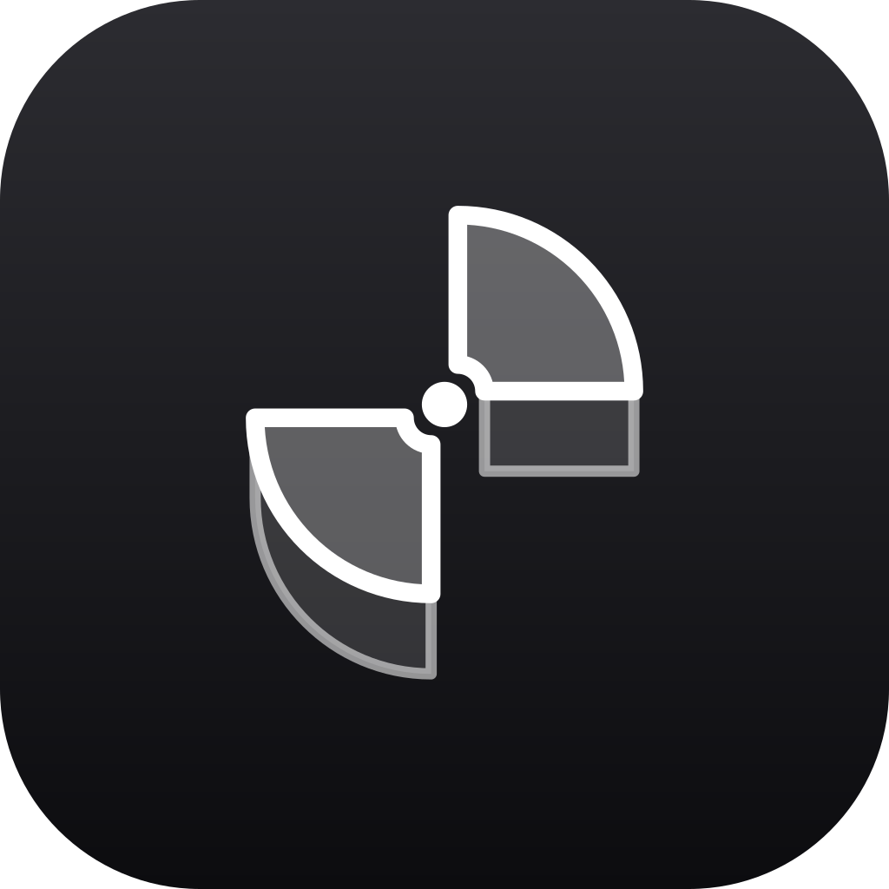

<p align="center">
  
</p>

<h1 align="center">Lane</h1>

<p align="center">
  <strong>Твоя музыка. Твой вайб. Твой Lane.</strong>
</p>

<p align="center">
  Музыкальный плеер для Windows, Android и Linux.
  <br>
  Персональное радио, тексты песен и твоя собственная музыкальная библиотека — в одном приложении.
</p>

<p align="center">
  <a href="https://github.com/therikky-lk/lanes-app/releases/download/releases/Lane-latest-setup.exe">
    
  </a>
  <a href="https://github.com/therikky-lk/lanes-app/releases/download/releases/Lane-latest.AppImage">
    
  </a>
  <a href="https://github.com/therikky-lk/lanes-app/releases/download/releases/Lane-latest.apk">
    
  </a>
</p>

---

## ✨ Возможности

### 🎧 Мой вайб
Бесконечный персональный музыкальный поток, который подстраивается под твои предпочтения. Lane использует лайки и историю прослушивания, чтобы подбирать музыку, а живой градиент на главной странице пульсирует в ритме воспроизведения.

### 🎤 Тексты песен
Тексты для большинства треков благодаря нескольким источникам: Liner, LRCLIB и YouTube Music. Поддерживаются синхронизированные строки, обычный текст и собственные LRC-файлы. Если нужного текста нет, его можно вставить вручную или загрузить с устройства.

### 🎵 Твоя музыкальная библиотека
Добавляй локальные треки в форматах MP3, FLAC, M4A и OGG. Lane считывает метаданные, обложки и встроенные тексты из аудиофайлов. Твоя локальная музыка хранится на устройстве.

### 🔗 Импорт плейлистов Spotify
Импортируй плейлисты по ссылке и сохраняй оригинальные обложки. Перенести любимую музыку в Lane становится проще.

### 🌅 Ежедневные миксы
10 миксов примерно по 50 треков, сформированных на основе твоих любимых исполнителей. Подборки обновляются каждый день, чтобы знакомая музыка сочеталась с новыми открытиями.

### 💿 Полные дискографии
Исследуй альбомы и синглы любимых исполнителей в одном месте. Переключайся между сеткой обложек и компактным списком.

### 🎮 Discord Rich Presence
Показывай, что слушаешь, прямо в Discord. Поддерживается работа с Discord из Flatpak и Snap, а также Vesktop, Equibop и Legcord. Lane автоматически переподключается после перезапуска Discord.

---

## 📥 Установка

Скачай последнюю версию Lane со страницы [GitHub Releases](https://github.com/therikky-lk/lanes-app/releases).

| Платформа | Установка |
|---|---|
| Windows 10/11 | `Lane-Setup-*.exe` — установщик или `Lane-*-portable.exe` — портативная версия |
| Linux (x86_64) | `Lane-*-x86_64.AppImage` — сделай файл исполняемым и запусти |
| Android 7+ | `Lane-vx.x.x.apk` - просто скачай |
| Ubuntu / Debian / Linux Mint | Установи пакет `lane_*_amd64.deb` |
| Fedora / openSUSE | Установи пакет `lane-*.x86_64.rpm` |

Для AppImage:

```bash
chmod +x Lane-*.AppImage
./Lane-*.AppImage
```

Для Ubuntu / Debian / Linux Mint:

```bash
sudo apt install ./lane_*_amd64.deb
```

Для Fedora / openSUSE:

```bash
sudo dnf install ./lane-*.x86_64.rpm
```

---

## 🛠 Сборка из исходников

### Требования
- Node.js
- pnpm
- Git

### Установка зависимостей

```bash
git clone https://github.com/therikky-lk/lanes-app.git
cd lanes-app
pnpm install
```

### Сборка

Сначала собери приложение:

```bash
pnpm exec vite build
```

Для Linux:

```bash
pnpm exec electron-builder --linux
```

Для Windows:

```bash
pnpm exec electron-builder --win
```

Готовые пакеты появятся в каталоге `release/`.

---

## 💙 О Lane

Lane создан для тех, кто хочет не просто включать музыку, а находить свой звук, возвращаться к любимым трекам и открывать новых исполнителей.

**Меньше поиска. Больше музыки. Больше твоего вайба.**

[Скачать Lane](https://github.com/therikky-lk/lanes-app/releases) · [Исходный код](https://github.com/therikky-lk/lanes-app)
