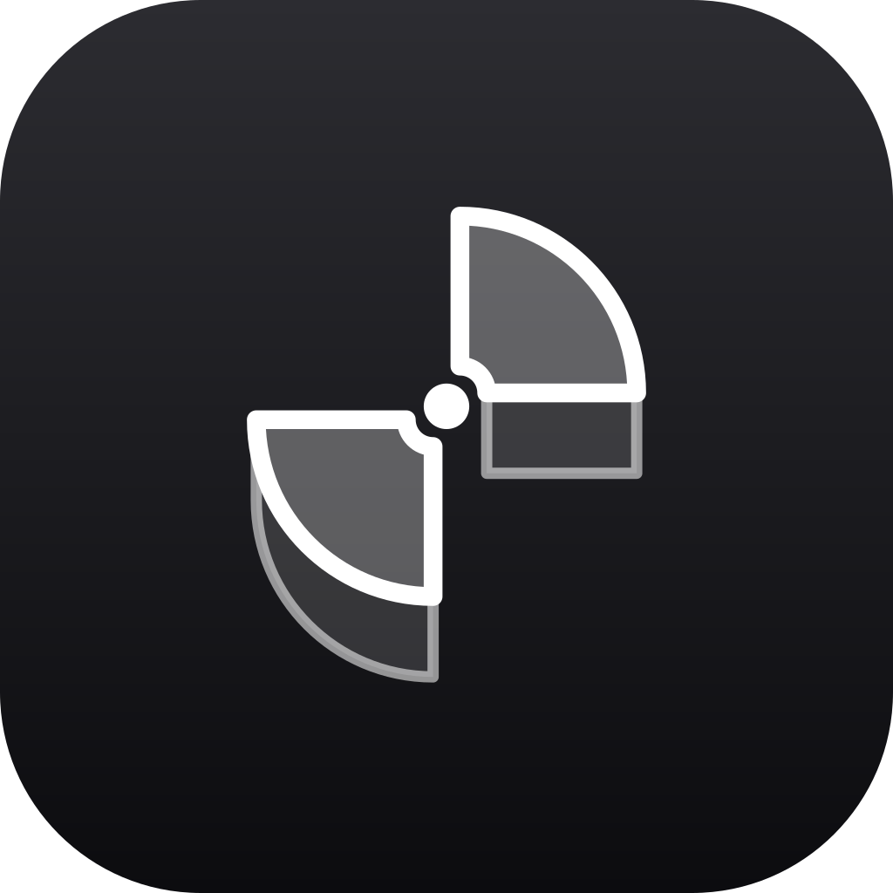

<p align="center">
  
</p>

<h1 align="center">Lane</h1>

<p align="center">
  <strong>Твоя музыка. Твой вайб. Твой Lane.</strong><br>
  Музыкальный плеер для Windows, macOS, Linux и Android
</p>

<p align="center">
  Персональное радио, любимые треки, тексты песен и собственная музыкальная библиотека — в одном приложении.
</p>

<p align="center">
  <a href="https://github.com/therikky-lk/lanes-app/releases">
    
  </a>
</p>

<p align="center">
  <a href="#возможности">Возможности</a> ·
  <a href="#скачать-и-установить">Установка</a> ·
  <a href="#сборка-из-исходников">Сборка</a> ·
  <a href="#помощь-и-обратная-связь">Обратная связь</a>
</p>

## Возможности

- **Моя волна** — персональный музыкальный поток, который учитывает лайки и историю прослушивания.
- **Библиотека и избранное** — собирай любимые треки и добавляй собственную музыку.
- **Треки, альбомы и исполнители** — открывай страницы релизов и артистов, изучай дискографии.
- **Плейлисты** — создавай свои подборки и делись публичными плейлистами.
- **Ссылки для обмена** — отправляй ссылки на треки, альбомы, исполнителей и плейлисты. На компьютере ссылка показывает информацию о материале и отправителе, а Lane может открыть её напрямую.
- **Тексты песен** — синхронизированные и обычные тексты, поддержка LRC и возможность добавить текст вручную.
- **Локальная музыка** — импортируй MP3, FLAC, M4A и OGG; приложение читает метаданные и обложки.
- **Импорт Spotify** — переноси плейлисты по ссылке.
- **Ежедневные миксы** — подборки на основе любимых исполнителей, которые обновляются каждый день.
- **Офлайн-кэш** — сохраняй доступные треки для прослушивания без сети.
- **Discord Rich Presence** — показывай друзьям, что сейчас играет.

## Скачать и установить

Открой [страницу последнего релиза](https://github.com/therikky-lk/lanes-app/releases) и выбери файл для своей системы.

| Система | Какой файл искать | Установка |
|---|---|---|
| Windows 10/11, 64-bit | `Lane-Setup-версия.exe` | Запусти установщик. Portable-версия запускается без установки. |
| macOS, Apple Silicon | `Lane-версия-arm64.dmg` | Открой DMG и перенеси Lane в Applications. |
| macOS, Intel | `Lane-версия-x64.dmg` | Открой DMG и перенеси Lane в Applications. |
| Linux, AppImage | `Lane-версия-x64.AppImage` | См. команду ниже. |
| Ubuntu / Debian | `lane_версия_amd64.deb` | Установи пакет командой ниже. |
| Fedora / openSUSE | `lane-версия.x86_64.rpm` | Установи пакет командой ниже. |
| Android | APK-файл релиза | Открой APK и подтверди установку. |

### Linux

Для AppImage:

```bash
chmod +x Lane-*.AppImage
./Lane-*.AppImage
```

Для Ubuntu, Debian или Linux Mint:

```bash
sudo apt install ./lane_*_amd64.deb
```

Для Fedora или openSUSE:

```bash
sudo dnf install ./lane-*.x86_64.rpm
```

### Android

1. Скачай APK со страницы релиза.
2. Открой файл и, если Android попросит, разреши установку приложений из этого источника.
3. Подтверди установку Lane.

### Если macOS не открывает приложение

Сборки macOS подписаны локально, но не имеют подписи Developer ID и нотарификации Apple. Если Gatekeeper заблокировал запуск, разреши его в **Системных настройках → Конфиденциальность и безопасность**.

Если macOS показывает сообщение, что приложение повреждено, сначала скачай его заново и проверь SHA-256 по файлу `SHA256SUMS-macos.txt` в релизе. Для проверенной сборки из официального релиза можно снять карантин только с Lane:

```bash
xattr -dr com.apple.quarantine /Applications/Lane.app
```

## Сборка из исходников

### Требования

- Node.js 22
- pnpm 10
- Git

### Подготовка

```bash
git clone https://github.com/therikky-lk/lanes-app.git
cd lanes-app
pnpm install
```

### Запуск и сборка

Запустить приложение для разработки:

```bash
pnpm dev
```

Собрать приложение:

```bash
pnpm build
```

Собрать веб-версию:

```bash
pnpm build:web
```

Сборка веб-версии появится в каталоге `dist-web/`.

### Сборки для отдельных платформ

Команды упаковки рассчитаны на соответствующую операционную систему. Android-сборке дополнительно нужны JDK 21 и Android SDK.

```bash
# Linux
pnpm electron:build:linux

# Windows
pnpm electron:build:win

# macOS (на Mac)
pnpm electron:build:mac
```

Релизные сборки для всех поддерживаемых платформ публикуются через GitHub Actions. Файлы локальной сборки Electron появятся в каталоге `release/`.

## Помощь и обратная связь

Нашёл ошибку или хочешь предложить улучшение? [Создай issue](https://github.com/therikky-lk/lanes-app/issues).

[Скачать Lane](https://github.com/therikky-lk/lanes-app/releases) · [Исходный код](https://github.com/therikky-lk/lanes-app) · [Сообщить о проблеме](https://github.com/therikky-lk/lanes-app/issues)
